# Peta Prasyarat & Graf Ketergantungan Jalur Peminatan
## IoT Learning Hub — Phase 6A: Specialization Dependency Graph & Overlap Audit

Dokumen ini memetakan hubungan ketergantungan (*dependency graph*) antara 40 bab kurikulum inti (*Core Curriculum*) dan 30 modul peminatan (*Specialization Modules*), serta menyajikan audit de-duplikasi untuk mencegah pengulangan materi (*zero content redundancy*).

- **Proyek**: Internet of Things Learning Hub (*From Connected Devices to Intelligent Systems*)
- **Pengembang & Kurator**: Aji Pamungkas Tri Nurcahyo (Institut Teknologi Sumatera - ITERA)
- **Kebijakan Anti-Slop**: Permanent Active (Mode: **DURING**)
- **Fase**: Phase 6A — Specialization Architecture & Curriculum Design
- **Tanggal Rilis**: 18 November 2026

---

## 1. Prinsip Dekomposisi & De-duplikasi Kurikulum

Untuk menjamin kedalaman akademik tanpa mengulang konten yang sudah tuntas di Level 1–4, setiap modul spesialisasi beroperasi di bawah prinsip:

$$\text{Core Curriculum (Fondasi Teori)} \xrightarrow{\text{Spesialisasi}} \text{Advanced Application} \xrightarrow{\text{Eksperimen}} \text{Quantitative Evaluation} \xrightarrow{\text{Sintesis}} \text{Capstone}$$

### Matriks Audit Overlap Materi (Anti-Duplication Audit)

| Topik Spesialisasi | Cakupan yang Sudah Selesai di Core (Ch 01–40) | Cakupan Baru yang Wajib Didalami di Track Spesialisasi | Batasan Larangan (Do NOT Re-teach) |
|---|---|---|---|
| **Matter & Thread** (Track A) | - Konsep arsitektur Thread (Border Router, Leader, Router, End Device) di Ch 34.<br>- Data model kluster dasar di Ch 34. | - Analisis kriptografi pertukaran kunci PASE/CASE (SPAKE2+) di A03.<br>- Skenario multi-admin fabrics commissioning lintas platform di A03.<br>- Koeksistensi spektrum RF 802.15.4 vs Wi-Fi di A01. | Dilarang mengulang diagram blok dasar atau pengantar definisi Matter/Thread. |
| **Industrial Modbus & OPC UA** (Track B) | - Frame format Modbus RTU/TCP & CRC-16 di Ch 33.<br>- Struktur dasar node OPC UA di Ch 33. | - Optimasi siklus polling deterministik multi-drop RS-485 bus di B03.<br>- Desain ruang alamat NodeSet XML mesin industri di B03.<br>- Segmentasi jaringan OT/IT model Purdue & IDMZ di B01. | Dilarang mengulang algoritma kalkulasi biner CRC-16 dasar atau sejarah fieldbus. |
| **Getaran & Predictive Maintenance** (Track B) | - Pengenalan akselerometer & fitur INT8 dasar di Ch 35. | - Fisika pemasangan sensor getaran & resonansi mekanis di B02.<br>- Transformasi Hilbert & analisis spektrum selubung (Envelope Analysis) di B04.<br>- Pelacakan frekuensi cacat bantalan BPFO/BPFI di B04. | Dilarang mengulang konsep umum apa itu getaran atau konsep dasar analog-to-digital. |
| **LoRaWAN & LPWAN** (Track C & E) | - Prinsip modulasi Chirp Spread Spectrum & parameter SF/BW/CR di Ch 18. | - Model redaman kanopi tanaman Weissberger di C03.<br>- Klirens Zona Fresnel medan berbukit & Link Budget di C03.<br>- Model kapasitas jenuh Pure ALOHA & tumbukan kanal kota di E04. | Dilarang mengulang pengenalan format paket LoRaWAN atau registrasi gateway dasar. |
| **TinyML & Edge AI** (Track D) | - Kuantisasi Post-Training INT8 & rumus zero-point/scale di Ch 35. | - Pelatihan sadar kuantisasi (Quantization-Aware Training / QAT) di D03.<br>- Distilasi pengetahuan (Knowledge Distillation) & pruning terstruktur di D03.<br>- Ekstraksi koefisien MFCC fixed-point Q15 di D02.<br>- Fusi sensor Extended Kalman Filter (EKF) di D04. | Dilarang mengulang definisi skala INT8 dasar atau pengenalan apa itu kecerdasan buatan. |
| **Digital Twin** (Track A & Track D) | - Persamaan termal 1-orde & analisis What-If di Ch 36. | - Fusi status dinamis EKF multi-sensor di D04.<br>- Model neraca air & evapotranspirasi FAO-56 di C05.<br>- Digital twin profil termal trafo listrik & peak shaving di A04. | Dilarang mengulang penurunan persamaan Newton cooling dasar tanpa perluasan spesifik. |

---

## 2. Matriks Pemetaan Prasyarat Kurikulum Inti (Core to Specialization Mapping)

Setiap modul spesialisasi memiliki rantai prasyarat (*prerequisite chain*) yang ketat dari 40 bab inti:

```
[Level 1: Ch 01-10]       [Level 2: Ch 11-20]       [Level 3: Ch 21-30]       [Level 4: Ch 31-40]
   Fondasi Fisik &           Jaringan, Protokol &       Gateway, Platform,         Sistem Lanjut, RTOS,
   Pemrograman C/MCU         Konektivitas Nirkabel      Database & Keamanan        TinyML & Digital Twin
        |                          |                          |                          |
        +--------------------------+--------------------------+--------------------------+
                                               |
                                               v
                             +-----------------------------------+
                             |   Specialization Tracks (30 M)    |
                             +-----------------------------------+
                             | Track A: Smart Home (A01 - A06)   |
                             | Track B: Industrial IIoT (B01-B06)|
                             | Track C: Smart Ag (C01 - C06)     |
                             | Track D: AIoT Edge (D01 - D06)    |
                             | Track E: Smart City (E01 - E06)   |
                             +-----------------------------------+
```

### Tabel Rantai Prasyarat Lengkap 30 Modul

| Modul Spesialisasi | Prasyarat Wajib Bab Inti (*Mandatory Prerequisite Chapters*) | Prasyarat Internal Modul Track | Kompetensi Inti yang Dibutuhkan |
|---|---|---|---|
| **A01** | Ch 01, Ch 02, Ch 11 | - | Pemahaman arsitektur sistem IoT, enkapsulasi paket IP, dan kanal Wi-Fi. |
| **A02** | Ch 07, Ch 08, Ch 23 | A01 | Pembacaan sensor analog/ADC, antarmuka I2C/SPI, dan logika pemrosesan edge deadband. |
| **A03** | Ch 28, Ch 34 | A01 | Arsitektur kriptografi TLS/X.509, konsep jaringan mesh Thread, dan model Matter. |
| **A04** | Ch 09, Ch 25, Ch 26 | A01, A02 | Aktuator relay/PWM, basis data deret waktu, dan dashboard peringatan. |
| **A05** | Ch 28, Ch 38 | A01, A03 | Kontrol akses keamanan, injeksi kesalahan transien, dan fail-safe recovery. |
| **A06 (Capstone)**| Ch 30, Ch 40 | A01, A02, A03, A04, A05 | Penguasaan seluruh integrasi otomasi bangunan mandiri & acceptance test. |
|---|---|---|---|
| **B01** | Ch 01, Ch 11, Ch 28 | - | Model Purdue, segmentasi VLAN, dan otentikasi pertukaran data. |
| **B02** | Ch 07, Ch 08, Ch 35 | B01 | Sampling ADC frekuensi tinggi, antarmuka SPI kecepatan tinggi, dan fisika sensor. |
| **B03** | Ch 16, Ch 33 | B01 | Protokol serial UART/RS-485, framing Modbus, dan pohon hierarki OPC UA. |
| **B04** | Ch 05, Ch 35 | B02 | Pemrograman memori buffer statis, FFT, dan ekstraksi fitur statistik sinyal. |
| **B05** | Ch 20, Ch 38 | B01, B03 | Model keandalan sistem MTBF, arsitektur redundansi hardware, dan injeksi fault. |
| **B06 (Capstone)**| Ch 30, Ch 40 | B01, B02, B03, B04, B05 | Penguasaan seluruh pipeline akuisisi getaran frekuensi tinggi, OPC UA, dan PdM. |
|---|---|---|---|
| **C01** | Ch 01, Ch 03, Ch 07 | - | Rangkaian listrik elektronika sensor, instrumentasi sensor analog tanah. |
| **C02** | Ch 07, Ch 10 | C01 | Kalibrasi instrumen, kompensasi temperatur ADC, dan evaluasi ketidakpastian baku. |
| **C03** | Ch 12, Ch 18 | C01 | Propagasi gelombang radio nirkabel, perhitungan Link Budget, dan modulasi LoRa. |
| **C04** | Ch 31 | C01, C03 | Manajemen sleep modes MCU, integral konsumsi energi, dan profiling baterai/PV. |
| **C05** | Ch 21, Ch 23, Ch 26 | C01, C02 | Skema payload telemetri, pemrosesan batas logika lokal, dan sistem alert. |
| **C06 (Capstone)**| Ch 30, Ch 40 | C01, C02, C03, C04, C05 | Penguasaan pemantauan mikroklimat LoRaWAN jarak jauh mandiri energi. |
|---|---|---|---|
| **D01** | Ch 04, Ch 05 | - | Arsitektur prosesor embedded, instruksi SIMD, alokasi memori heap/stack. |
| **D02** | Ch 05, Ch 23, Ch 35 | D01 | Pemfilteran sinyal digital streaming, aritmatika integer fixed-point, ekstraksi fitur. |
| **D03** | Ch 35 | D01, D02 | Kuantisasi INT8, model training neural network, kompresi bobot tflite. |
| **D04** | Ch 07, Ch 23, Ch 36 | D02 | Fusi sensor analitis, estimasi status state-space, pemodelan dinamika fisik. |
| **D05** | Ch 27, Ch 29, Ch 35 | D03 | Fleet telemetry, pembaruan firmware OTA, benchmarking latensi inferensi. |
| **D06 (Capstone)**| Ch 30, Ch 40 | D01, D02, D03, D04, D05 | Penguasaan sistem inferensi fusi multimodal terakselerasi di mikrokontroler. |
|---|---|---|---|
| **E01** | Ch 01, Ch 02, Ch 11 | - | Arsitektur jaringan telekomunikasi skala kota, protokol routing IP. |
| **E02** | Ch 11, Ch 12 | E01 | Persamaan transmisi Friis, redaman ruang bebas, perhitungan daya terima RSSI. |
| **E03** | Ch 11, Ch 18, Ch 31 | E01, E02 | Protokol LPWAN, spesifikasi 3GPP seluler IoT, timer hemat daya PSM/eDRX. |
| **E04** | Ch 14, Ch 20, Ch 37 | E01, E03 | Teori antrean broker MQTT, probabilitas ALOHA, partisi sharding skala masif. |
| **E05** | Ch 21, Ch 25, Ch 39 | E01 | Basis data deret waktu spasial, indeks GeoJSON, regulasi privasi data warga. |
| **E06 (Capstone)**| Ch 30, Ch 40 | E01, E02, E03, E04, E05 | Penguasaan platform telekomunikasi IoT kota multi-tenant dengan jaminan SLA. |

---

## 3. Graf Ketergantungan Antar-Modul (Mermaid Dependency Graph)

Grafik alur berikut menggambarkan jalur belajar yang direkomendasikan (*Learning Pathway*) untuk masing-masing peminatan:

```mermaid
flowchart TD
  subgraph TrackA["Track A: Smart Home & Building Automation"]
    A01["A01: Smart Building Architecture"] --> A02["A02: Occupancy & IAQ Sensing"]
    A01 --> A03["A03: Matter Core & Thread Mesh"]
    A02 --> A04["A04: Energy Optimization & Peak-Shaving"]
    A03 --> A05["A05: Life-Safety & Interlocks"]
    A04 --> A06["A06: Building Capstone"]
    A05 --> A06
  end

  subgraph TrackB["Track B: Industrial IoT & Predictive Maintenance"]
    B01["B01: Industrial Automation & Purdue OT/IT"] --> B02["B02: High-Freq Vibration Physics"]
    B01 --> B03["B03: Modbus RTU/TCP & OPC UA"]
    B02 --> B04["B04: Time-Frequency Feature Eng."]
    B03 --> B05["B05: Functional Safety (SIL/IEC 61508)"]
    B04 --> B06["B06: Predictive Maintenance Capstone"]
    B05 --> B06
  end

  subgraph TrackC["Track C: Smart Agriculture & Environmental Monitoring"]
    C01["C01: Agro-Ecological Sensing"] --> C02["C02: Precision In-Situ Calibration"]
    C01 --> C03["C03: LoRaWAN Topography & Canopy"]
    C03 --> C04["C04: Energy Harvesting & Supercap"]
    C02 --> C05["C05: Evapotranspiration FAO-56"]
    C04 --> C06["C06: Agro-Environmental Capstone"]
    C05 --> C06
  end

  subgraph TrackD["Track D: AIoT & Edge Intelligence"]
    D01["D01: Embedded AI Architecture & NPU"] --> D02["D02: Edge Feature Engineering"]
    D02 --> D03["D03: Deep TinyML (QAT & Pruning)"]
    D02 --> D04["D04: Multimodal Sensor Fusion (EKF)"]
    D03 --> D05["D05: Model Lifecycle & Drift"]
    D04 --> D06["D06: AIoT Multimodal Capstone"]
    D05 --> D06
  end

  subgraph TrackE["Track E: IoT for Telecom & Smart Cities"]
    E01["E01: Smart City IoT Systems"] --> E02["E02: Urban RF Propagation (COST 231)"]
    E01 --> E05["E05: Geospatial Telemetry & Geofencing"]
    E02 --> E03["E03: Cellular IoT (NB-IoT/LTE-M)"]
    E03 --> E04["E04: Municipal Contention & SLA"]
    E04 --> E06["E06: City-Scale Network Capstone"]
    E05 --> E06
  end
```



---

## 4. Evaluasi Keterkaitan Antar-Jalur Peminatan (Cross-Track Synergy)

Meskipun kelima peminatan memiliki target vertikal yang berbeda, terdapat jembatan sinergi metodologis yang memungkinkan mahasiswa mengambil modul lintas jalur peminatan:

1. **Sinergi Track B (Industrial) & Track D (AIoT)**:
   - Modul `B04` (Fitur Getaran & Transformasi Hilbert) dapat menjadi input langsung ke modul `D03` (Pelatihan TinyML QAT) untuk menciptakan sistem pemeliharaan prediktif cerdas berbasis kecerdasan buatan terakselerasi.
2. **Sinergi Track C (Agriculture) & Track E (Telecom)**:
   - Modul `C03` (Propagasi LoRaWAN & Klirens Fresnel) melengkapi modul `E02` (Propagasi Urban COST 231 Hata), memberikan mahasiswa pemahaman holistik tentang perambatan gelombang radio baik di pedesaan/perkebunan maupun di perkotaan padat.
3. **Sinergi Track A (Smart Home) & Track E (Smart Cities)**:
   - Modul `A04` (Sub-metering energi gedung) berintegrasi langsung dengan modul `E01` (Arsitektur data terbuka NGSI-LD kota pintar), memodelkan bagaimana ribuan bangunan cerdas melaporkan profil konsumsi daya ke sistem smart grid kotamadya.

